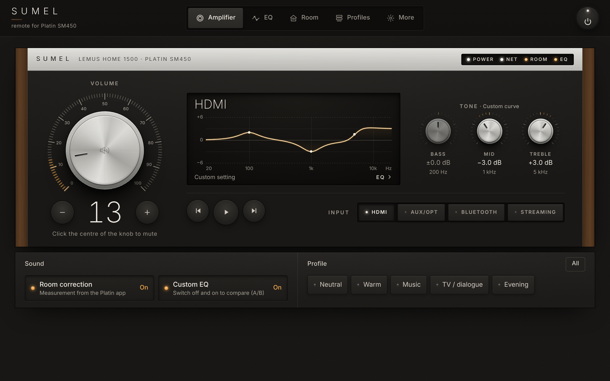
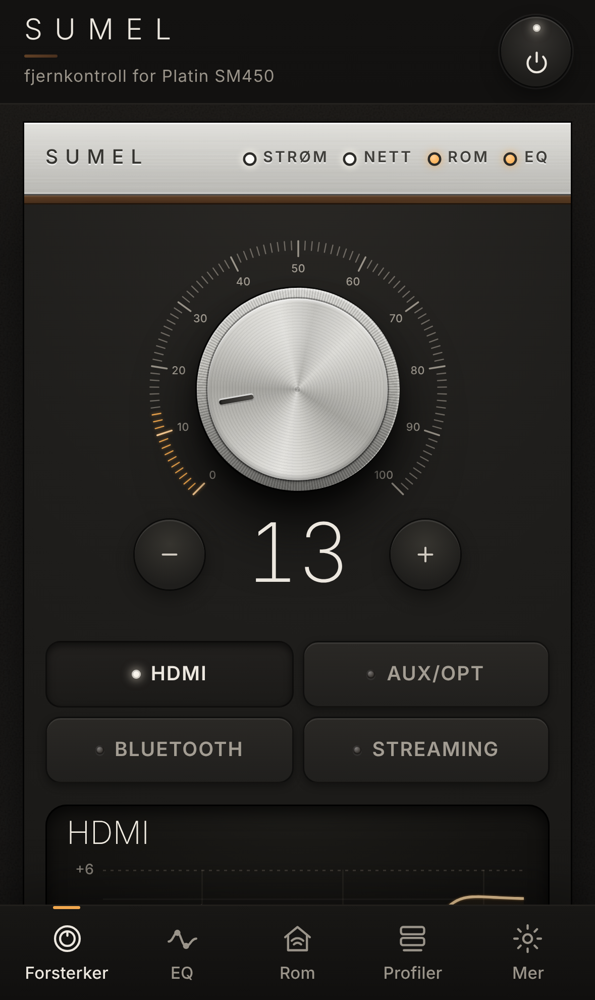
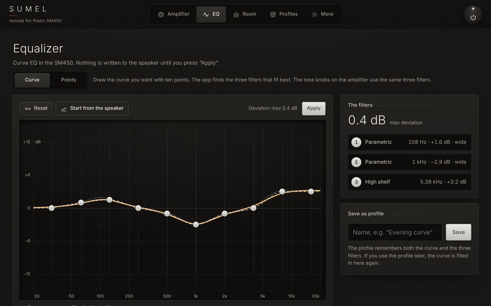
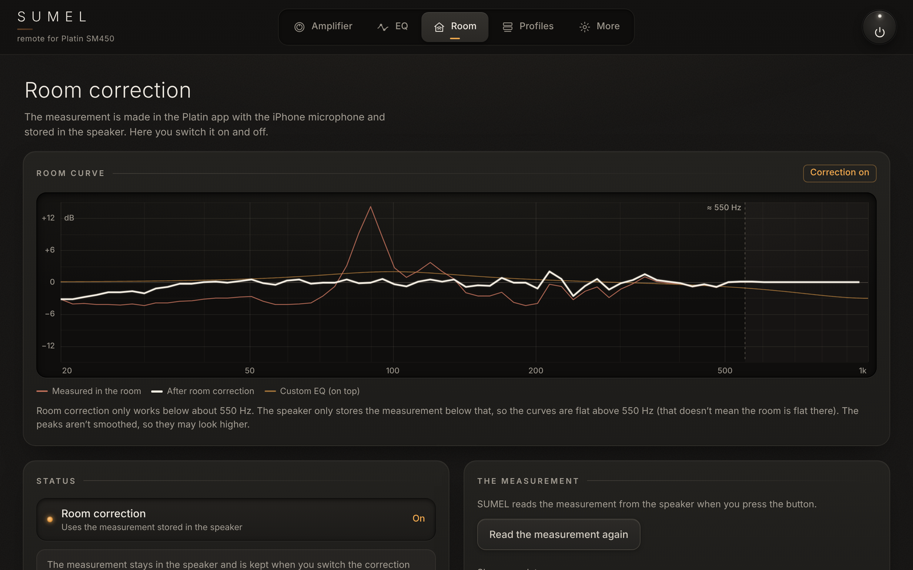
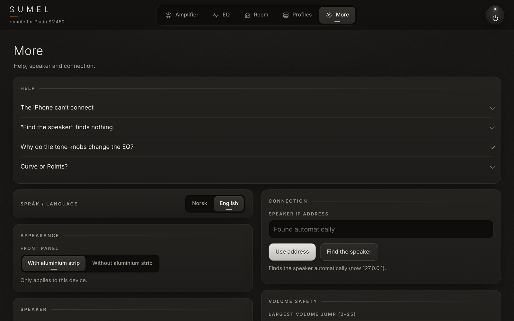

# SUMEL – remote for Platin SM450

A small local remote control for speakers built on the Platin SM450 amplifier module, used in your browser on a PC or phone.

*Made out of frustration with poor or non-existent apps. =)*

> [!WARNING]
> **Unofficial.** SUMEL is not made by, endorsed by or affiliated with Lemus or Platin, and neither of them supports it.
> It **writes to the speaker's DSP** (EQ filters and switches). Use it at your own risk.
> It has only been tested on **one speaker: a Lemus HOME 1500** (Platin SM450, firmware MCU 177 / LS9 15262).

SUMEL is "LEMUS" spelled backwards. It is a hobby project: one speaker, one home network, a lot of careful packet reading.

<p align="center">
  
  &nbsp;
  
</p>

**English or Norwegian.** SUMEL is in English by default. It switches to Norwegian only when your browser (or Windows, for the installer and tray icon) is set to Norwegian. You can change it any time under **More → Språk / Language**, and the choice is remembered on that device.

## What it is

- A **Python backend** that runs on your PC and talks to the speaker over the local network. Standard library only, no extra packages needed.
- A **web app** served by that backend. Open it in a browser on the PC, or on a phone on the same network (it can be added to the home screen as an app).
- **No cloud, no account, no telemetry.** Everything stays on your network.

## Getting started

**Before you install**

1. **Set up the speaker with the manufacturer's app first** (for example the Platin app, the Lemus app or Google Home) and check that you can play music to it. SUMEL cannot put a speaker on Wi-Fi.
2. **Same network.** The PC must be on the same home network as the speaker: not a guest network, and not one with Wi-Fi client isolation.
3. **Note the speaker's IP address** in case the automatic search fails. You find it in your router's list of connected devices or in the manufacturer's app. Tip: reserve a fixed address for the speaker in the router.
4. **Room correction is measured in the Platin app** (Room EQ). SUMEL can switch it on and off and show the stored curve, but cannot make a new measurement.

**What happens on first start**

1. Your browser opens SUMEL, and a SUMEL icon appears next to the clock (it may be hidden under **^**).
2. SUMEL searches your network. It only checks which devices answer; no commands are sent, and the volume is never changed on its own.
3. When the speaker is found, its name shows on the front panel and the address is saved for next time.
4. If it is still searching after about 20 seconds, press **Enter IP address** (or go to **More → Connection**), type the speaker's address and press **Use address**.
5. If the speaker is in standby, SUMEL reads the EQ and the room curve as soon as it wakes up. Until then, EQ changes are blocked so nothing is overwritten by mistake.

**Profiles and EQ.** The speaker has three slots for your own EQ filters. Applying a profile or a curve replaces those filters. A high-pass filter is kept, and SUMEL asks first if the filters in the speaker don't come from one of its profiles. **Undo** brings the previous filters back.

**Other speakers than the Lemus HOME 1500.** SUMEL does not check the model yet; it connects to the first LibreSync device that answers and every control is available. Try volume and input first, and please [tell us](#compatibility) how it went before you use EQ.

**Access code.** A 6-digit code is created on first start. You don't need it on the PC itself. A phone enters it once, or scans the QR code under **More → Use on iPhone** (works on Android too). The code is also in the tray menu.

**Settings** are stored in `%APPDATA%\LemusRemote\config.json` on Windows (`~/.config/lemus-remote/config.json` elsewhere). The Windows program also writes a log, `lemus.log`, in the same folder. If you attach the log to an issue, remove the line with the access code first.

## Features

Status is for the tested Lemus HOME 1500. "Confirmed" means it was tried on the real speaker and the speaker reported the new value back.

| Feature | Status |
|---|---|
| Volume, with a **volume guard** (no big jumps, volume is never sent when the app opens) | Confirmed |
| Input selection (HDMI, AUX/OPT, Bluetooth, Streaming) | Confirmed |
| Play / pause / next / previous (streaming sources) | Confirmed |
| Power off | Confirmed |
| Power on from standby, by playing 3 s of silence over DLNA, then returning to the previous input | Confirmed (takes about 5–8 s) |
| Mute | The speaker's own mute state is read and followed. Sending mute to it is a hypothesis; if the speaker does not confirm, SUMEL falls back to volume 0 and restores the level afterwards |
| Room correction on/off | Confirmed |
| Show the room curve stored in the speaker (measured and corrected) | Decoded and checked against the Platin app's graph (within about ±0.3 dB on the corrected curve) |
| Own EQ on/off, for instant A/B against no EQ | Confirmed |
| EQ filters: create, change, delete | Confirmed for Parametric EQ. For low/high shelving and 12 dB high-pass, SUMEL's coefficients are bit-exact (±1 LSB) against captures from the Platin app, but writing them from SUMEL has not been checked separately. The other filter types (12 dB low-pass, 6 dB high/low-pass) are learned automatically when you save one in the Platin app while SUMEL is running |
| EQ filters: turn a band off/on | Uses the same command the Platin app sends (seen acknowledged by the speaker); not tested separately from SUMEL |
| **Curve** mode, tone knobs, profiles | New. They use the filter commands above (Parametric EQ and low/high shelving); each write is read back, but the features as a whole have not been listening-tested on the speaker |
| Live status when the remote or the Platin app changes something | Confirmed. Room correction and own-EQ on/off are not announced by the speaker, so SUMEL picks those up by polling every 10 s |

**Curve mode.** Drag 10 points into the sound you want. SUMEL tries Parametric EQ and low/high shelving filters with different frequencies, gains and widths and picks the (at most) 3 filters that together come closest. The preview is calculated from the exact fixed-point coefficients the DSP will get, so what you see is what the speaker does. Nothing is sent until you press **Apply**. Why only 3? The SM450 reserves only 3 biquad filters for app EQ (see [Safety](#safety)).

**Points mode.** Edit the three filters directly (type, frequency, gain, width). Each change is sent right away.

**Tone knobs.** Bass, mid and treble on the front panel. They use the same three filter slots as the EQ tab.

**Profiles.** Built-in profiles (Neutral, Warm, Music, TV/dialogue, Evening) that you can edit and reset, plus your own. A/B between two profiles, undo, and backup/restore as a JSON file. Profiles are stored on the PC, never in the speaker.

**Other.** English and Norwegian UI (English by default, switch under More → Språk / Language). Works as a home-screen app (PWA) on iPhone and Android. Other devices than the PC need an access code once. On Windows, a tray icon with autostart.

<p align="center">
  
</p>

<p align="center">
  
  &nbsp;
  
</p>

### What it does not do

- **New room measurements.** These are still made in the Platin app (or the Lemus app). SUMEL only switches room correction on/off and shows the stored curve.
- **Factory reset, firmware updates, crossovers, per-channel EQ, delay** or the manufacturer's licensed algorithms. These are deliberately out of reach (see below).
- **Speaker presets 1–3.** On the SM450 they revert to the app EQ after a few seconds, so the feature was removed.

## Safety

SUMEL writes to a DSP that also holds the speaker manufacturer's own tuning. These are the guard rails:

- **Hard limit of 3 EQ bands.** During testing, writing a **fourth** band (slot 3) caused a loud pop and the speakers sounded wrong afterwards. The SM450 datasheet v1.3 explains why: of the ten biquad filters in the DSP's PRE-EQ2 block, only three are reserved for app control; the rest (and the other EQ blocks) belong to the manufacturer's tuning. Slot 3 most likely overwrote part of that tuning. The limit (`MAX_BANDS = 3` in `lemus_remote/protocol.py`) is enforced in the protocol layer, the device layer, the profiles and the UI. A band found in slot 3 or higher is shown as "cannot be changed" and can only be deleted.
  - The DSP loads its stored setup when the speaker starts, so a full power cycle (mains off and on) should bring back the original tuning. That is not confirmed.
- **Closed command list.** Only known commands are sent, all of them seen working on the speaker except the mute command (see Features; it has a volume-0 fallback). On port 7777, only four message boxes can be addressed (register, transport, volume, mute). Factory reset and firmware upgrade live in the same message space and cannot be reached from the code.
- **No factory, crossover or firmware changes.** None of the manufacturer settings are touched.
- **Volume guard.** A single volume command can move at most 25 steps (configurable 2–25 under More). The knob sends small steps. Volume is never sent automatically when the app opens or reconnects.
- **Every setting change is confirmed** (volume, input, power, EQ bands, own EQ, room correction): the app waits until the speaker reports the new value before it reports success. Play/pause/next/previous are sent without a confirmation.
- **Device discovery sends no control commands.** It uses a standard UPnP search, reads the device description and only opens/closes a TCP connection.

Note that the speaker itself has **no authentication** on the local network. Anyone on your network can control it, with or without SUMEL. SUMEL's own web server uses plain HTTP and is meant for your home network only; do not expose it to the internet.

## Install

### Windows installer

1. Download `SUMEL-Setup-<version>.exe` from the **[latest release](https://github.com/erognmo-afk/SUMEL-platin-sm450-remote/releases/latest)** (no GitHub account needed).
2. Run the installer. It adds a firewall rule (private networks only) so phones can reach the PC, and optionally starts SUMEL with Windows.
3. SUMEL opens in your browser. It has no window of its own; it lives as an **icon next to the clock**. Right-click it for the phone address, the access code, autostart and Quit.

**About Windows security warnings.** The installer is **not code-signed** (signing costs money for a hobby project).

- **SmartScreen** may say "Windows protected your PC". Click **More info → Run anyway**.
- **Smart App Control** (Windows 11) blocks unsigned programs completely, with no "run anyway" option. If it is turned on, use the Python version below instead.
- Some antivirus programs (for example Norton) may quarantine an unsigned program or use their own firewall. You may need to restore it and allow `SUMEL.exe`.

Uninstall from **Settings → Apps**. Your settings stay in `%APPDATA%\LemusRemote` (the old name is kept on purpose) until you delete that folder.

### Run from source

Needs **Python 3.10 or newer**. No other packages.

```bash
git clone https://github.com/erognmo-afk/SUMEL-platin-sm450-remote.git SUMEL
cd SUMEL
python -m lemus_remote --open          # on Windows: py -m lemus_remote --open
```

SUMEL finds the speaker on its own. If it does not, give the address (it is saved):

```bash
python -m lemus_remote --open --host 192.168.0.6
```

`--open` opens http://localhost:8080 in your browser (without it, open that address yourself). Stop with Ctrl+C.

| Option | Meaning |
|---|---|
| `--host <ip>` | the speaker's IP address (saved for next time) |
| `--auto` | forget the saved address and find the speaker automatically |
| `--name 1500` | pick a speaker by name if there are several |
| `--port 8080` | port for the web app (default 8080) |
| `--local-only` | only reachable from this PC, not from phones |
| `--no-auth` | do not ask other devices for the access code |
| `--no-scan` | skip the TCP fallback search on the local /24 network |
| `--no-luci` | do not use port 7777 (volume and playback will then not work) |
| `--config <file>` | path to the settings file |
| `--tray` | tray icon instead of console (needs `pystray` and `pillow`, see `requirements-windows.txt`) |
| `-v` | verbose logging |

`python -m lemus_remote --help` lists all options (the help text is in Norwegian).

On Windows there are helpers in the repo root: `start.bat`, `lag-snarvei.ps1` (desktop shortcut, `-Oppstart` for autostart) and `tillat-mobil.bat` (firewall rule for phone access). Their names are in Norwegian.

**Linux and macOS** run from source the same way. The automated tests pass on Linux, but SUMEL has only been used with the real speaker from Windows.

## Use it from your phone

1. The phone must be on the **same network** as the PC (not a guest network). On Windows, the network must be set to **Private**.
2. Get the address from the **tray menu** ("Address for iPhone") or scan the **QR code under More**. It looks like `http://192.168.0.9:8080`.
3. Enter the **access code** once per device (shown in the tray menu and under More on the PC; the QR link logs in automatically).
4. **Add to Home Screen** (Safari: Share → Add to Home Screen; Android: menu → Add to home screen) to get a full-screen SUMEL icon.

The PC must be on with SUMEL running. Giving the PC a fixed IP address in your router keeps the address stable.

**Phone cannot connect?**

- **Wi-Fi client isolation.** Some routers (many ISP home gateways, for example) stop Wi-Fi devices from talking to each other, especially on guest networks. Turn isolation off if the router allows it, connect the PC by **cable**, or use **Tailscale** on both PC and phone and open `http://<PC's Tailscale address>:8080`.
- **Firewall or antivirus** on the PC may block port 8080. Allow `SUMEL.exe` (or `python.exe` when running from source).
- A **VPN** on the PC can also get in the way.

## Compatibility

SUMEL looks for devices that describe themselves as **Libre Wireless / LibreSync** and accept a connection on the control port 50006.

| Device | Status |
|---|---|
| Lemus HOME 1500 (Platin SM450, MCU 177 / LS9 15262) | Tested (the only device SUMEL has been used with) |
| Other speakers built on the Platin SM450 amplifier module with the Libre LS9 streaming module. Our SM450 reports Cast model name "Njord" and product name "2018 SM450 INTEGRATED AMPLIFIER". Other Lemus HOME models may use the same module, but we have not checked which ones | Expected to work, untested. Other firmware versions may behave differently |
| Newer Platin modules (for example SM455) or Libre LS10-based devices | Unknown. LS10 is reported (by a third party) to wrap port 7777 in TLS, so volume and transport would likely not work |
| Platin Stereo Hub | Same LibreSync protocol family, but the SM450 differs in several places (source codes, frame formats, EQ). Not tested or supported; see [aiolibresync](https://github.com/drsound/aiolibresync) |

**Have a different model?** Please open an issue with the model name, the firmware versions (shown under **More → Speaker**) and what worked or didn't. Note: SUMEL does not check the model yet. Every control, including EQ and profiles, is available as soon as it connects. On another model, try volume and input first.

## How it works

- **Port 50006 (LibreSync system control).** A binary protocol, tunnelled to the amplifier's control chip. Used for power, input, EQ and room-correction switches, EQ filters and the room curve. It is a broadcast bus: every connected client sees every reply, which is how SUMEL follows the remote and the Platin app live.
- **Port 7777 (LUCI).** Volume, transport and mute, through a fixed allow-list of message boxes.
- **Port 38400 (UPnP).** Device description for discovery, and DLNA AVTransport to play a short silent clip that wakes the amplifier from standby.
- **EQ filters** are written as biquad coefficients that SUMEL calculates itself (RBJ Audio EQ Cookbook formulas at 48 kHz, 8.24 fixed point). For Parametric EQ, low/high shelving and 12 dB high-pass they match the Platin app's own writes bit for bit (within 1 LSB); the remaining types are learned from the Platin app.
- **Room curve.** 140 bytes: a measured curve and a corrected curve in 1/12-octave steps from 20 Hz to about 1 kHz. On our speaker the correction only acts below about 550 Hz.

From the SM450 datasheet v1.3, in short: the amplifier goes to standby after 20 minutes without signal (not adjustable), wakes by itself when a signal arrives (in about 8 s), and the DSP cannot be reached while in standby. Firmware updates come automatically from the manufacturer's server and do not overwrite the DSP setup.

The full protocol notes, with what is confirmed and what is still a guess, are in [PROTOCOL.md](PROTOCOL.md).

## Development

Run the tests (they use a simulated SM450 built from frames the real speaker sent):

```bash
python -m unittest discover -s tests -t tests
```

Run the web app against a simulated speaker, no hardware needed:

```bash
python tools/dev_server.py 8090
```

Then open http://localhost:8090. `--find-none` simulates a network where discovery finds nothing; `--no-native-mute` exercises the mute fallback.

**Windows installer.** `packaging/` holds the PyInstaller spec, the Inno Setup script (Norwegian and English) and `build.ps1`. The GitHub Actions workflow `.github/workflows/windows.yml` runs the tests on Windows, builds `SUMEL.exe` and `SUMEL-Setup-<version>.exe`, smoke-tests the exe and a silent install/uninstall, and uploads the **SUMEL-Setup** artifact. It runs on **Run workflow** or when a `v*` tag is pushed. A tag, or **Run workflow** with *release* ticked, also publishes the installer as a GitHub Release. Locally on Windows (Inno Setup 6.3+):

```powershell
py -m pip install -r requirements-windows.txt
powershell -ExecutionPolicy Bypass -File .\packaging\build.ps1
```

The Python package is still called `lemus_remote` (the project's earlier name). Code comments and some helper scripts are in Norwegian.

## Credits

- [aiolibresync](https://github.com/drsound/aiolibresync) (MIT) for the documented LibreSync protocol on Platin Stereo Hub, which made this possible.
- The RBJ *Audio EQ Cookbook* for the biquad formulas.
- Hardware facts are from the SM450 datasheet v1.3, summarised in our own words.

"Lemus", "Platin", "Google Home" and "Chromecast" are trademarks of their respective owners. SUMEL is an unofficial project and is not affiliated with, endorsed by or supported by any of them.

## License

[MIT](LICENSE). Copyright (c) 2026 SUMEL contributors.

---

## Norsk

SUMEL er en uoffisiell fjernkontroll for høyttalere med Platin SM450, laget fordi appene var dårlige eller manglet. Et lite Python-program på PC-en styrer høyttaleren over hjemmenettet, og du bruker den i nettleseren på PC-en eller mobilen. Den har volum med volumvakt, inngang, strøm (av, og på via DLNA), avspilling, demping, romkorreksjon av/på med visning av romkurven, egen EQ (Kurve med ti punkter som blir til tre filtre, eller Punkter), tonehjul og profiler. Alt blir på hjemmenettet, uten sky.

SUMEL er ikke laget av eller tilknyttet Lemus eller Platin. Den skriver til DSP-en, så bruk den på egen risiko. Den er bare testet på Lemus HOME 1500. Programmet tar høyst tre EQ-bånd: et fjerde bånd ga et smell i testen og overskrev trolig produsentens tuning (ifølge SM450 datasheet v1.3 er bare tre filtre satt av til appens EQ).

**Installere:** Last ned `SUMEL-Setup-….exe` fra [siste release](https://github.com/erognmo-afk/SUMEL-platin-sm450-remote/releases/latest) (krever ingen GitHub-konto), og kjør den. Programmet er ikke signert: ved «Windows beskyttet PC-en» trykker du **Mer info → Kjør likevel**. Er Smart App Control på, blokkeres det helt; bruk da Python-varianten: installer Python 3.10 eller nyere og kjør `py -m lemus_remote --open` i mappen (eventuelt med `--host <ip>`). SUMEL ligger som et ikon ved klokken, der du også finner adressen og tilgangskoden for mobilen. Appen er på engelsk som standard, men blir norsk når nettleseren eller Windows er på norsk. Du kan bytte når som helst under **Mer → Språk / Language**.

**Første gang:** Sett opp høyttaleren med produsentens app (eller Google Home) først, og la PC-en være på samme nett (ikke gjestenettet). SUMEL leter selv. Finner den ikke høyttaleren etter ca. 20 sekunder, trykker du **Skriv IP-adresse** og skriver inn adressen fra ruteren. Står høyttaleren i standby, leses EQ-en når den våkner. En profil erstatter de tre EQ-filtrene i høyttaleren, men beholder et høypassfilter og spør først hvis filtrene ikke kommer fra en profil. Andre modeller enn Lemus HOME 1500 er ikke testet: prøv volum og inngang før du bruker EQ.
