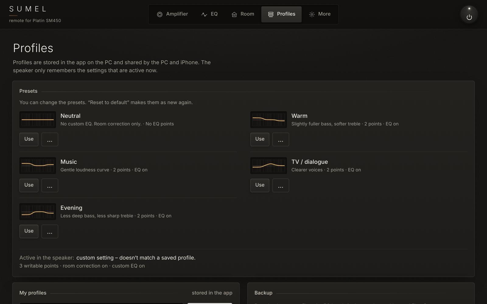

<h1 align="center">SUMEL</h1>

<p align="center">
  <b>Unofficial local remote for speakers with the Platin SM450 amplifier module</b><br>
  <sub>Windows program · used in the browser on your PC or phone · no cloud, no account</sub>
</p>

> [!WARNING]
> **Unofficial.** SUMEL is not made by, endorsed by or affiliated with Lemus or Platin, and neither of them supports it.
> It writes to the speaker's DSP (EQ filters and switches), so use it at your own risk.
> It has been tested on one speaker only: a **Lemus HOME 1500** (firmware MCU 177 / LS9 15262).

<p align="center">
  
</p>
<p align="center">
  
  
  
</p>
<p align="center"><sub>The amplifier on a PC. Below: on a phone, Curve EQ and profiles.</sub></p>

## Download

**[Download the latest release →](https://github.com/erognmo-afk/SUMEL-platin-sm450-remote/releases/latest)**

Get `SUMEL-Setup-<version>.exe` (64-bit Windows, tested on Windows 11; no GitHub account needed) and run it. SUMEL opens in your browser and stays as an icon next to the clock. Phones need nothing installed: they open SUMEL from the PC over your home network. On Linux and macOS, [run it from source](#run-from-source).

> [!NOTE]
> The installer is not code-signed. If **SmartScreen** says "Windows protected your PC", click **More info → Run anyway**.
> **Smart App Control** (Windows 11) blocks unsigned programs completely. If it is on, [run SUMEL from source](#run-from-source) instead.

## What it does

- **Volume** with the knob, the ± buttons, the mouse wheel or the keyboard. A **volume guard** limits each jump (2–25 steps, 25 by default) and never sends a volume when the app opens.
- **Mute** by pressing the centre of the volume knob (or **M**).
- **Input**: HDMI, AUX/OPT, Bluetooth and Streaming, as the speaker reports them.
- **Power**: standby, and waking from standby. SUMEL plays 3 s of silence over DLNA, which wakes the amplifier, and then switches back to the input it had.
- **Playback**: play/pause, next and previous on streaming sources.
- **Curve EQ**: drag ten points into the sound you want. SUMEL finds the (at most) three filters that come closest and shows the exact result. Nothing is sent until you press **Apply**.
- **Points**: set the three filters directly (type, frequency, level, width). Each change is sent right away.
- **Tone knobs**: bass, mid and treble on the front panel. They share the same three filters.
- **Profiles**: five presets (Neutral, Warm, Music, TV / dialogue, Evening) that you can edit and reset, plus your own. **A/B** between two profiles, **Custom EQ on/off** for an instant comparison with no EQ, and **Undo**.
- **Room correction** on/off, with the room curve stored in the speaker (measured and corrected).
- **Backup and restore**: your profiles and the speaker's EQ in one JSON file.
- **Live status**: follows the remote and the Platin app.
- **English and Norwegian**, following your browser (the installer and tray icon follow Windows). Switch any time under **More → Språk / Language**. The front panel comes with the aluminium strip (default) or without it (**More → Appearance**).
- **Phone**: works in the phone's browser and as a home-screen app. Other devices than the PC need a 6-digit access code once.
- **Local only**: no cloud, no account, no telemetry.

### How well it is tested

On the Lemus HOME 1500. "Confirmed" means it was tried on the real speaker and the speaker reported the new value back.

| Function | Status |
|---|---|
| Volume, input, play/pause/next/previous, standby | Confirmed |
| Waking from standby | Confirmed (about 5–8 s). Switching back to the previous input afterwards is not yet confirmed on the speaker |
| Mute | The speaker's own mute state is read and followed. Sending mute is not confirmed yet: if the speaker does not confirm within about 2 s, SUMEL sets the volume to 0 and restores it when you unmute |
| Room correction on/off, Custom EQ on/off | Confirmed |
| Room curve | Decoded and checked against the Platin app's graph (within about ±0.3 dB on the corrected curve) |
| EQ filters (Parametric EQ): create, change, delete | Confirmed |
| Low/high shelving and 12 dB high-pass | Coefficients match the Platin app's own writes bit for bit (±1 LSB). Writing them from SUMEL is not checked separately |
| Other filter types (12 dB low-pass, 6 dB high/low-pass) | Learned when you save one in the Platin app while SUMEL is running |
| Turning a single filter off/on | Same command as the Platin app, seen acknowledged by the speaker. Not tested separately from SUMEL |
| Curve EQ, tone knobs, profiles, A/B, backup | Built on the filter commands above, and every write is read back. Not yet listening-tested as a whole |
| Live status | Confirmed. Room correction and Custom EQ are not announced by the speaker, so SUMEL polls them every 10 s |
| Phone (browser and home screen) | Layout and controls tested in a phone-sized browser only. Not yet tested on a real iPhone or Android phone |

**Not included:** new room measurements (make them in the Platin app; SUMEL switches the correction and shows the curve), factory reset, firmware updates, crossovers, per-channel EQ and delay. The speaker presets 1–3 are left out too: on the SM450 they revert to the app EQ after a few seconds.

## Getting started

**Before you install**

1. **Set up the speaker with the manufacturer's app** (for example the Platin app) or Google Home, and check that it plays music. SUMEL cannot put a speaker on Wi-Fi.
2. **Use the same network.** The PC must be on the same home network as the speaker: not a guest network, and not one with Wi-Fi client isolation.
3. **Note the speaker's IP address** in case the search fails. It is in your router's list of connected devices or in the manufacturer's app. Reserving a fixed address for the speaker in the router helps.

**First start**

1. Your browser opens SUMEL, and an icon appears next to the clock (it may be hidden under **^**).
2. SUMEL searches your network. It only checks which devices answer: no commands are sent and the volume is never changed.
3. When the speaker is found, its name shows on the front panel and the address is saved.
4. If it is still searching after about 20 seconds, an **Enter IP address** button and some tips appear. Type the address (for example `192.168.0.6`) and press **Use address**. The same field is under **More → Connection**.
5. If the speaker is in standby, SUMEL reads the EQ and the room curve as soon as it wakes. Until then EQ changes are blocked, so nothing is overwritten by mistake.

**Profiles and EQ.** A profile or a curve replaces the filters in the speaker's three EQ slots. A high-pass filter is kept. SUMEL asks first if the filters in the speaker don't come from a profile, and tells you if a profile doesn't fit next to the filters it keeps. **Undo** brings the previous filters back.

**Another speaker than the Lemus HOME 1500?** SUMEL does not check the model yet, so every control is available. Try volume and input first, and please [report](#compatibility) how it went before you use EQ.

## Install

### Windows installer

1. Download `SUMEL-Setup-<version>.exe` from the [latest release](https://github.com/erognmo-afk/SUMEL-platin-sm450-remote/releases/latest).
2. Run it and accept the administrator prompt. The installer adds a firewall rule (private networks only) so phones can reach the PC, and can add a desktop icon and start SUMEL with Windows. An earlier version is upgraded in place, and its settings are kept.
3. SUMEL opens in your browser. It has no window of its own. Right-click the icon next to the clock for **Open SUMEL**, the phone address and the access code (click to copy), **Start with Windows** and **Quit**.

Some antivirus programs quarantine unsigned programs or use their own firewall. Restore it if needed and allow `SUMEL.exe`.

**Settings and log.** `%APPDATA%\LemusRemote\config.json` on Windows (the folder keeps the project's earlier name, so upgrades keep your settings), `~/.config/lemus-remote/config.json` elsewhere. The Windows program also writes `lemus.log` there. Remove the line with the access code before you attach the log to an issue.

Uninstall from **Settings → Apps**. Your settings stay until you delete that folder.

### Run from source

Needs **Python 3.10 or newer** and nothing else.

```bash
git clone https://github.com/erognmo-afk/SUMEL-platin-sm450-remote.git SUMEL
cd SUMEL
python -m lemus_remote --open          # on Windows: py -m lemus_remote --open
```

SUMEL finds the speaker on its own. If it does not, give the address once (it is saved):

```bash
python -m lemus_remote --open --host 192.168.0.6
```

SUMEL runs at http://localhost:8080 (`--open` opens it). Stop with Ctrl+C.

| Option | Meaning |
|---|---|
| `--host <ip>` | the speaker's IP address (saved for next time) |
| `--auto` | forget the saved address and search again |
| `--name 1500` | pick a speaker by name if there are several |
| `--port 8080` | port for the web app (default 8080) |
| `--local-only` | reachable from this PC only, not from phones |
| `--no-auth` | don't ask other devices for the access code |
| `--no-scan` | skip the TCP fallback search on the local network |
| `--no-luci` | don't use port 7777 (volume and playback will not work) |
| `--config <file>` | path to the settings file |
| `--open` | open the web app in the browser at start |
| `--tray` | icon next to the clock instead of a console (default in `SUMEL.exe`; from source it needs `pystray` and `pillow`) |
| `--no-tray` | keep the console window, also in `SUMEL.exe` |
| `--background` | with `--tray`: don't open the browser (used when Windows starts) |
| `-v` | verbose logging |
| `--version` | show the version |

`--help` and the console messages are in Norwegian. On Windows the repo root also has small helpers with Norwegian names: `start.bat` (start and open the browser), `lag-snarvei.ps1` (desktop shortcut; `-Oppstart` also starts it with Windows) and `tillat-mobil.bat` (firewall rule for phone access).

**Linux and macOS** run from source the same way. The automated tests pass on Linux, but SUMEL has only been used with the real speaker from Windows.

## Use it from your phone

1. The phone must be on the **same network** as the PC (not a guest network). On Windows, that network must be set to **Private**.
2. Get the address from the tray menu (**Address for iPhone**, click to copy) or scan the QR code under **More → Use on iPhone**. It looks like `http://192.168.0.20:8080`.
3. Enter the 6-digit **access code** once per device. It is shown in the tray menu and under **More** on the PC, and the QR link signs in automatically.
4. **Add to Home Screen** (Safari: Share → Add to Home Screen; Android: menu → Add to home screen) for a full-screen SUMEL icon.

The PC must be on with SUMEL running. A fixed address for the PC in your router keeps the phone link working.

> Phone use has so far only been tested in a phone-sized browser, not on a real iPhone or Android phone. Feedback is welcome.

**Phone cannot connect?**

- **Wi-Fi client isolation.** Some routers (many ISP home gateways, for example) keep Wi-Fi devices apart, especially on guest networks. Turn isolation off if you can, connect the PC to the router by **cable**, or use **Tailscale** on both PC and phone and open `http://<PC's Tailscale address>:8080`.
- **Firewall or antivirus** on the PC may block port 8080. Allow `SUMEL.exe` (or `python.exe` when running from source).
- A **VPN** on the PC can also get in the way.

## Safety

SUMEL writes to a DSP that also holds the speaker manufacturer's own tuning. These are the guard rails:

- **Only the three EQ slots the SM450 sets aside for the app.** In early testing, writing a fourth band caused a loud pop, and the speakers sounded wrong afterwards. The SM450 datasheet v1.3 explains why: of the ten biquad filters in the DSP's PRE-EQ2 block, only three are reserved for app control. The rest, and the other EQ blocks, hold the manufacturer's tuning. The limit (`MAX_BANDS = 3` in `lemus_remote/protocol.py`) is enforced where the commands are built, and again in the device layer, the profiles and the app.
- **Filters in other slots are never touched.** A filter found outside the three slots (for example the manufacturer's tuning) is shown as locked. SUMEL does not change it, switch it off or delete it. If something ended up there, switch the speaker fully off at the mains (power switch or wall socket) for 10 seconds. That probably reloads the factory setup, but it is not confirmed.
- **Volume guard.** One volume command moves at most 25 steps by default (set 2–25 under **More → Volume safety**). The knob sends small steps, and no volume is sent when the app opens or reconnects. The limit is enforced by the program on the PC, so a browser cannot get around it.
- **Closed command list.** Only known commands are sent, all seen working on the speaker except the mute command (which has the volume-0 fallback). On port 7777 only four message boxes can be addressed: register, transport, volume and mute. Factory reset and firmware upgrade live in the same message space and cannot be reached from the code.
- **Every setting change is confirmed:** the app waits for the speaker to report the new value before it shows success (play/pause/next/previous are sent without confirmation). **Discovery sends no control commands:** it uses a standard UPnP search, reads the device description and only opens and closes a TCP connection.

The speaker itself has **no authentication** on the local network: anyone on your network can control it, with or without SUMEL. SUMEL's own web server uses plain HTTP and is meant for your home network only. Do not expose it to the internet.

## Compatibility

SUMEL looks for devices that describe themselves as **Libre Wireless / LibreSync** and accept a connection on control port 50006.

| Device | Status |
|---|---|
| Lemus HOME 1500 (Platin SM450, MCU 177 / LS9 15262) | Tested. The only device SUMEL has been used with |
| Other speakers with the Platin SM450 amplifier module and the Libre LS9 streaming module. Ours reports Cast model name "Njord" and product name "2018 SM450 INTEGRATED AMPLIFIER" | Expected to work, untested. Other firmware versions may behave differently |
| Newer Platin modules (for example SM455) or Libre LS10-based devices | Unknown. LS10 is reported (by a third party) to wrap port 7777 in TLS, so volume and playback would likely not work |
| Platin Stereo Hub | Same LibreSync protocol family, but the SM450 differs in several places. Not supported; see [aiolibresync](https://github.com/drsound/aiolibresync) |

**Have a different model?** Please open an issue with the model name, the firmware versions (under **More → Speaker**) and what worked or didn't.

## How it works

A small Python server (standard library only) runs on the PC, talks to the speaker over the local network and serves the web app to your browsers.

- **Port 50006 (LibreSync system control):** power, input, EQ and room-correction switches, EQ filters and the room curve. Every connected client sees every reply, which is how SUMEL follows the remote and the Platin app live.
- **Port 7777 (LUCI):** volume, playback and mute, through a fixed allow-list of message boxes.
- **Port 38400 (UPnP):** the device description used by discovery, and DLNA playback of a short silent clip to wake the amplifier.
- **EQ filters** are biquad coefficients that SUMEL calculates itself (RBJ Audio EQ Cookbook, 48 kHz, 8.24 fixed point). The Curve EQ preview uses the same fixed-point coefficients, so what you see is what the speaker gets.

According to the SM450 datasheet, the amplifier goes to standby after 20 minutes without signal (not adjustable), wakes by itself when a signal arrives, and its DSP cannot be reached while in standby.

The full protocol notes, with what is confirmed and what is still a guess, are in **[PROTOCOL.md](PROTOCOL.md)**.

## Development

Run the tests. They use a simulated SM450 built from frames the real speaker sent:

```bash
python -m unittest discover -s tests -t tests
```

Run the web app against the simulated speaker, no hardware needed, then open http://localhost:8090:

```bash
python tools/dev_server.py 8090
```

`--find-none` simulates a network where the search finds nothing; `--no-native-mute` exercises the mute fallback.

**Windows installer.** `packaging/` holds the PyInstaller spec, the Inno Setup script (English and Norwegian) and `build.ps1`. The GitHub Actions workflow `.github/workflows/windows.yml` runs the tests on Windows, builds `SUMEL.exe` and the installer, smoke-tests the exe and a silent install and uninstall, and uploads the installer as an artifact. A `v*` tag, or **Run workflow** with *release* ticked, also publishes it as a GitHub Release. To build locally on Windows (Inno Setup 6.3 or newer):

```powershell
py -m pip install -r requirements-windows.txt
powershell -ExecutionPolicy Bypass -File .\packaging\build.ps1
```

The Python package is still called `lemus_remote`, after the project's earlier name. Code comments and some helper scripts are in Norwegian.

## Changelog

What changed in each version is in **[CHANGELOG.md](CHANGELOG.md)**. Installers are on the [releases page](https://github.com/erognmo-afk/SUMEL-platin-sm450-remote/releases).

## Credits

*Made out of frustration with poor or non-existent apps. =)*

SUMEL is "LEMUS" spelled backwards. It is a hobby project: one speaker, one home network and a lot of careful packet reading.

- [aiolibresync](https://github.com/drsound/aiolibresync) (MIT), whose documented LibreSync protocol for the Platin Stereo Hub made this possible.
- The RBJ *Audio EQ Cookbook* for the biquad formulas.
- Hardware facts from the SM450 datasheet v1.3, summarised in our own words.

"Lemus", "Platin", "Google Home" and "Chromecast" are trademarks of their respective owners. SUMEL is not affiliated with, endorsed by or supported by any of them.

## License

[MIT](LICENSE). Copyright (c) 2026 SUMEL contributors.

---

## Norsk

SUMEL er en uoffisiell, lokal fjernkontroll for høyttalere med forsterkermodulen Platin SM450. Et lite program på PC-en styrer høyttaleren over hjemmenettet, og du bruker den i nettleseren på PC-en eller mobilen. Alt blir på hjemmenettet: ingen sky, ingen konto.

SUMEL er ikke laget av eller tilknyttet Lemus eller Platin. Den skriver til DSP-en, så bruk den på egen risiko. Den er bare testet på en Lemus HOME 1500.

**Funksjoner:** volum med volumvakt, demping (trykk på volumhjulet), inngang, standby og vekking (tilbake til samme inngang), avspilling, Kurve-EQ (ti punkter blir til høyst tre filtre), Punkter, tonehjul, profiler (ferdige og egne, som kan redigeres), A/B, romkorreksjon av/på med visning av romkurven, og sikkerhetskopi. Appen blir norsk når nettleseren er på norsk, og du kan bytte under **Mer → Språk / Language**.

**Installasjon:** Last ned `SUMEL-Setup-<versjon>.exe` fra [siste release](https://github.com/erognmo-afk/SUMEL-platin-sm450-remote/releases/latest) (64-biters Windows, testet på Windows 11, krever ingen GitHub-konto) og kjør den. Programmet er ikke kodesignert: ved «Windows beskyttet PC-en din» trykker du **Mer info → Kjør likevel**. Blokkerer Smart App Control programmet, kan du kjøre fra kildekoden i stedet: installer Python 3.10 eller nyere og kjør `py -m lemus_remote --open` i SUMEL-mappen.

**Første gang:** Sett opp høyttaleren med produsentens app eller Google Home først, og ha PC-en på samme nett (ikke gjestenettet). SUMEL leter selv. Finner den ikke høyttaleren etter ca. 20 sekunder, trykker du **Skriv IP-adresse**. Står høyttaleren i standby, leses EQ-en når den våkner, og EQ-endringer er sperret til da. På mobilen åpner du adressen fra menyen ved klokken eller QR-koden under **Mer**. Tilgangskoden skrives inn én gang per enhet (QR-koden logger inn av seg selv). Mobilbruk er så langt bare testet i en nettleser i mobilstørrelse, ikke på en ekte telefon.

**EQ-plassene:** SUMEL skriver bare til de tre EQ-plassene SM450 setter av til appen. Et fjerde bånd ga et smell i testen og overskrev trolig en del av produsentens tuning. Filtre på andre plasser vises som låst og røres aldri. Har noe havnet der, slår du høyttaleren helt av (strømbryter eller stikkontakt) i 10 sekunder. Det laster trolig fabrikkoppsettet inn igjen (ikke bekreftet). Andre modeller enn Lemus HOME 1500 er ikke testet: prøv volum og inngang før du bruker EQ.
